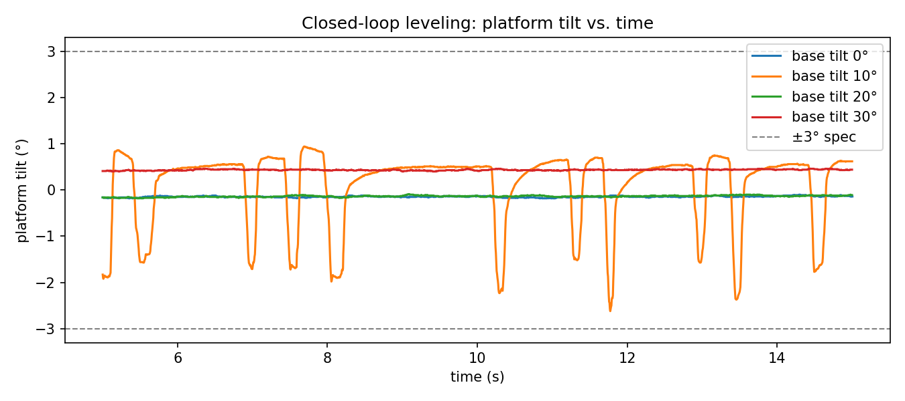

# Self-Leveling IMU Platform

A single-axis platform that stays level while its base tilts. An Arduino Mega reads an IMU over I2C, fuses accelerometer and gyroscope data with a complementary filter, and drives a servo in a closed loop at 200 Hz.

**Demo video (30 s):** https://youtu.be/GUl8yr4yl0U

**Result:** the platform holds level within **±2.6° (worst case)** at base tilts up to **30°**, with a **200 Hz** control loop.

---

## The problem

I wanted to build the smallest real version of what robots, drones and stabilizers do all the time: **measure tilt with an imperfect sensor, then correct it with a motor in real time.** The hard parts are the same at any size: noisy sensors, drifting sensors, actuator slop, and timing.

## How it works

```
IMU (MPU-6500)  --I2C-->  Arduino Mega 2560  --PWM-->  SG90 servo  -->  platform
     ^                         |                                           |
     |                         +--UART/USB--> Python logger (CSV, plots)   |
     +-------------------------- sensor rides on the platform <------------+
```

1. **Sense.** The Arduino reads the IMU directly over I2C (no sensor library): wake the chip by writing `0x00` to register `0x6B`, then burst-read 14 bytes starting at `0x3B` (accelerometer, temperature, gyroscope). Raw values are 16-bit two's complement, scaled to g and °/s.
2. **Calibrate.** At startup, 500 gyro samples are averaged to remove the gyro's bias.
3. **Fuse.** A complementary filter combines the two sensors:
   `angle = 0.98 × (angle + gyro_rate × dt) + 0.02 × accel_angle`
   The gyro is smooth but drifts; the accelerometer never drifts but is noisy. Together they give a stable angle.
4. **Correct.** Integral control: every loop nudges the servo command opposite the measured tilt, in proportion to the error, until the platform reads ~0°. A 0.5° deadband stops it from chasing gear slop.
5. **Timing.** A fixed 5 ms loop (`micros()`), so `dt` is constant: **200 Hz**.

Because the IMU sits **on the platform**, the loop measures where the platform really is, not where the servo thinks it is. That is what lets it work despite the servo's backlash.

## Hardware

| Part | Details |
| --- | --- |
| Microcontroller | Arduino Mega 2560 (I2C on pins 20 SDA / 21 SCL, 400 kHz) |
| IMU | GY-521 breakout board with an **MPU-6500** chip (address `0x68`) |
| Actuator | SG90 micro servo, signal on pin 9 (PWM) |
| Base | Rigid box the servo is taped to, so the whole base can be tilted |
| Laptop | MacBook (Python 3, pyserial, matplotlib) |

## Results

Measured with `telemetry/measure_level.py`: 15-second runs, first 5 s skipped while the loop settles, worst-case and mean angle over the last 10 s. Base tilt read with a phone level. Logs in `logs/`.

| Base tilt | Leveling error (worst) | Mean angle | Servo command |
| --- | --- | --- | --- |
| 0° | ±0.18° | −0.15° | 88.7 |
| ~10° | ±2.62° | +0.12° | 97.0 |
| ~20° | ±0.18° | −0.14° | 108.8 |
| ~30° | ±0.46° | +0.43° | 118.3 |



All four runs stay inside the ±3° spec. The 10° run shows a limit cycle (slow creep, then a sudden snap) caused by gear backlash in the SG90; that's where the ±2.62° worst case comes from. Analysis: [`analysis/leveling.ipynb`](analysis/leveling.ipynb).

| Spec | Target | Measured | |
| --- | --- | --- | --- |
| Leveling error | ±3° at up to 30° tilt | **±2.6°** worst case | ✅ |
| Filtered drift, 60 s at rest | < 1° | **0.04°** (gyro only: 0.26°) | ✅ |
| Control loop rate | ≥ 100 Hz | **200 Hz** with the servo running | ✅ |

Before closing the loop, an open-loop sweep characterized the servo: about **0.88° of platform tilt per degree commanded** and **~3° of gear backlash** (the gap between the up-sweep and the down-sweep).

## Surprises (what broke and how I fixed it)

- **The kit's chip wasn't what the label said.** `WHO_AM_I` returned `0x70`, not `0x68`: it's an MPU-6500, not an MPU-6050. Same register map, so the code works, but the docs were corrected.
- **Gyro-only drifted to −21.6° of fake tilt** in about 2 minutes after a bumped calibration, while the filtered angle stayed within 0.3°. That's why the complementary filter exists.
- **Gyro bias came out different every run** (+1.6, −4.2, −2.6 °/s). The servo jumped to 90° right *before* calibration, and since the IMU rides on the platform, the gyro was measuring the servo's motion. A 1.5 s delay before calibrating fixed it (bias ≈ 0.5 °/s).
- **Level read −90° instead of 0°.** The chip is mounted a quarter-turn on the platform, so I swapped axes in the angle formula (`atan2(ay, -ax)`) instead of re-mounting it.
- **The platform "hunts"** (small back-and-forth corrections) on some runs. The SG90 moves in 1° steps and has gear backlash, so the loop overshoots slightly. Raising the deadband from 0.3° to 0.5° reduced it. I report the worst case rather than the best run.
- **The live plot was empty at first** on macOS because `ser.in_waiting` never reported data; reading with `readline()` fixed it.

## Trade-offs

- **Integral control only, no full PID.** The servo is already a position actuator, so the command just needs to keep adjusting until the tilt is zero. Adding derivative/proportional terms wasn't needed to meet spec (a deliberate non-goal).
- **Cheap servo.** The SG90's backlash is the main error source. A servo with less slop, or a motor with an encoder, would tighten the worst case.
- **Single axis.** Two-axis leveling was out of scope.

## Repository layout

| Folder / file | What it is |
| --- | --- |
| `spec.md` | Goal, constraints, acceptance criteria, non-goals |
| `who_am_i/` | First I2C read: confirms the chip (`0x70` = MPU-6500) |
| `raw_imu/` | Burst-read of all 6 axes, printed as CSV |
| `angles/` | Gyro bias calibration + accelerometer, gyro-only and filtered angles |
| `servo_test/` | Command the servo to an angle over serial |
| `sweep/` | Open-loop sweep: gain, level point and backlash |
| `level/` | **Closed-loop leveling** (the final firmware) |
| `telemetry/` | Python: live plot, drift analysis, leveling measurements |
| `logs/` | CSV logs from the measurement runs |
| `notes.md` | Session-by-session test notes |

## Run it

1. Wire the GY-521 (VCC → 5V, GND → GND, SDA → 20, SCL → 21) and the SG90 (brown → GND, red → 5V, orange → pin 9).
2. Upload `level/level.ino` with the Arduino IDE. Keep the platform still for ~2 s while the gyro calibrates.
3. Close the Serial Monitor, then measure a run: `python3 telemetry/measure_level.py 20` (20 = base tilt in degrees).

## What's next

- Publish the IMU data to **ROS 2** as standard `sensor_msgs/Imu` messages on `/imu/data`, visualize it in RViz and record it with rosbag.
- Then: a multi-robot consensus simulation in ROS 2, including a robot that sends bad data.

---

Edit Bautista Florentino · Computer Engineering, Sacramento State · [github.com/edit-bautista](https://github.com/edit-bautista)
